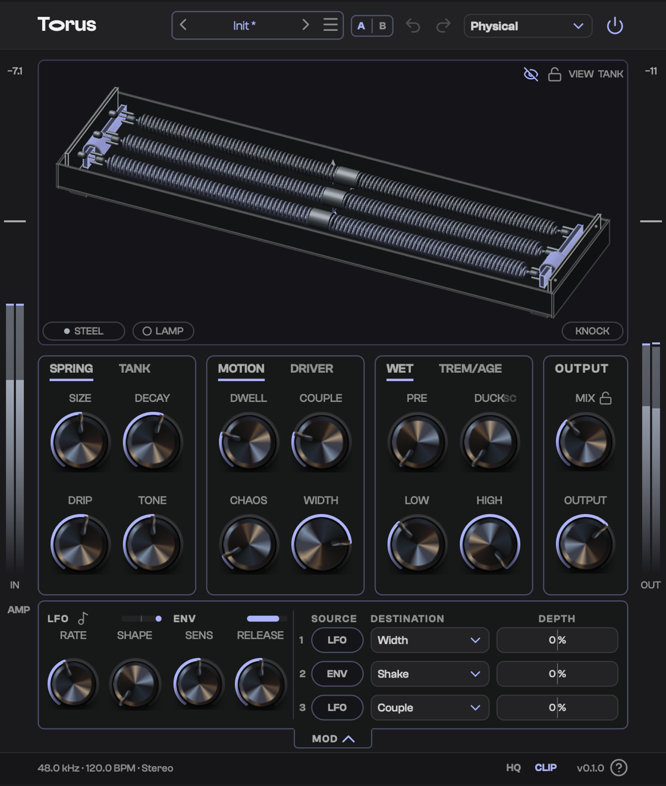

# Torus — Releases

This repository hosts **release binaries only** for Torus, a spring reverb
audio plugin (Standalone, VST3, CLAP, and AU on macOS).

See the [Releases](../../releases) page for downloads.

## Installing

- **macOS** (`Torus-<version>-macOS.dmg`): drag `Torus.vst3` onto
  "VST3 Plug-Ins", `Torus.component` onto "AU Plug-Ins (Components)",
  `Torus.clap` onto "CLAP Plug-Ins" (`/Library/Audio/Plug-Ins/CLAP`; create it
  with `sudo mkdir -p /Library/Audio/Plug-Ins/CLAP` if it is missing) and
  `Torus.app` onto "Applications". The per-user folders under
  `~/Library/Audio/Plug-Ins/` work too. The beta is not signed yet; the DMG's
  `Install.txt` has the one-line `xattr` command that clears the quarantine.
- **Windows** (`Torus-<version>-Windows.zip`): copy `Torus.vst3` to
  `C:\Program Files\Common Files\VST3` and `Torus.clap` to
  `C:\Program Files\Common Files\CLAP`. `Torus.exe` is the standalone app.
- **Linux** (`Torus-<version>-Linux.zip`): copy `Torus.vst3` to `~/.vst3` and
  `Torus.clap` to `~/.clap`. `Torus` is the standalone app.

Rescan plug-ins in your DAW after installing.
